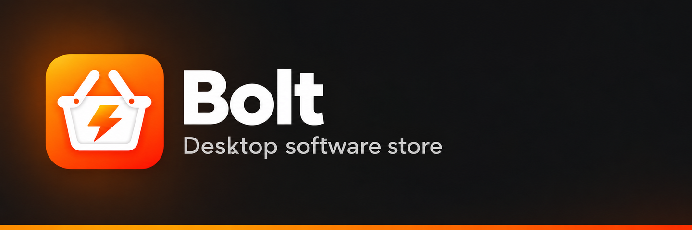

# Bolt

<p align="center">
  
</p>

[English](README.md) | [Deutsch](README.de.md) | **Français** | [Español](README.es.md) | [Português](README.pt.md) | [中文](README.zh.md) | [日本語](README.ja.md) | [Magyar](README.hu.md)

Une boutique de logiciels pour le bureau (Avalonia 12 + [KD.Avalonia.Rice](https://www.nuget.org/packages/KD.Avalonia.Rice)).
Elle n'a pas de catalogue propre : on y ajoute des dépôts GitHub, GitLab (gitlab.com ou auto-hébergé) et Codeberg
(Forgejo/Gitea), Bolt choisit parmi leurs versions (releases) le paquet adapté au système et l'installe avec
**l'installateur du système hôte** :

| Système | Paquet | Installateur |
|---------|--------|--------------|
| Debian / Ubuntu et dérivés | `.deb` | `pkexec apt-get` |
| Fedora / RHEL | `.rpm` | `pkexec dnf` |
| openSUSE / SLES | `.rpm` | `pkexec zypper` |
| Windows | `.msi`, `.exe` | `msiexec` / l'installateur lui-même (UAC) |

## Fonctionnement

- **Ajout d'un dépôt** : la boutique n'accepte un dépôt que s'il possède une version contenant un paquet adapté au
  système (format + architecture). Sinon, elle indique pourquoi.
- **Écran principal** : en haut les applications installées, en bas celles installables, 20 par page dans chaque groupe.
- **Mises à jour** : recherche et installation des mises à jour par application installée ou pour toutes à la fois.
- **État** : au démarrage, Bolt vérifie que les paquets installés sont toujours présents (supprimé en dehors de
  Bolt → l'application revient dans la liste des installables).
- **Jetons d'API** : jeton optionnel par hôte (limites de débit, dépôts privés) dans les paramètres.
- **Langue** : l'interface est disponible en anglais (par défaut), allemand, français, espagnol, portugais, chinois,
  japonais et hongrois ; le choix se fait dans les paramètres et s'applique immédiatement.
- **Données** : SQLite, `~/.local/share/bolt/bolt.db` (Windows : `%LOCALAPPDATA%\bolt\bolt.db`), icônes à côté
  dans le dossier `icons`.

## Métadonnées `.bolt`

Un dépôt peut indiquer dans le fichier `.bolt/bolt.json` comment il doit apparaître dans la boutique :

```json
{
  "name": "My App",
  "version": "1.2.3",
  "author": "Quelqu'un",
  "icon": "icon.png"
}
```

- Tous les champs sont optionnels ; nom absent → nom du dépôt, auteur absent → propriétaire du dépôt.
- `icon` est un chemin relatif au dossier `.bolt` (png, jpg, webp, ico, bmp) et ne peut pas pointer en dehors.
- La boutique relit le fichier lors de l'ajout et à chaque recherche de mises à jour.
- Si l'utilisateur définit une icône personnalisée pour une application, elle est enregistrée localement et la
  boutique ne lit plus le dossier `.bolt` (retour arrière via l'élément de menu
  *Réinitialiser l'icône (.bolt)*).

## Développement

```sh
dotnet build
dotnet test
dotnet run --project src/Bolt.App
```

- `src/Bolt.Core` – modèle de données (EF Core + SQLite), clients de forges, sélection des paquets, installateurs,
  `StoreService`.
- `src/Bolt.App` – interface Avalonia (MVVM, CommunityToolkit.Mvvm).
- `src/Bolt.*/Resources/Strings*.resx` – textes de l'interface et des messages, un fichier par langue
  (`Strings.resx` est l'anglais).
- `tests/Bolt.Core.Tests` – tests xUnit.

Nouvelle migration : `dotnet ef migrations add <Nom> --project src/Bolt.Core --output-dir Data/Migrations`.
